# CampusFind — University Lost & Found (Angular frontend)

Students report what they lost, log what they found, and claim belongings with evidence; the lost & found office reviews claims and confirms the handover. Built with **Angular 21 (standalone + signals) · PrimeNG 21 (Aura, custom palette, dark mode) · Tailwind 4 · Chart.js · Leaflet + OpenStreetMap · pdf.js**.

Live: https://vspark.learn2earntech.com · API repo: https://github.com/MalikHamza007/campusfind-backend

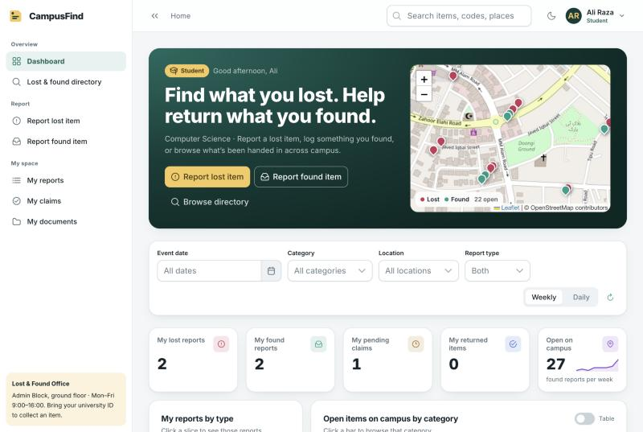

## Features
| Area | What you can do |
|---|---|
| Auth | Register (university email, live password rules), sign in, sign out, session restored on reload (refresh cookie → in-memory access token), auto-refresh on 401, safe `returnUrl`, guest/auth/role guards, forbidden page |
| Reports | Report lost / found items with photos (private upload with progress), date, category, distinguishing details, and a **map picker** (search via OpenStreetMap Nominatim, campus landmarks, click-to-label) |
| Directory | PrimeNG table with search, type/category/status/location/date filters, sort, server pagination, map view of pins, URL-synced filters |
| Claims | "This is mine" claim with linked lost report + evidence (images/PDF), status timeline, withdraw |
| Office (admin) | Side-by-side claim review (finder's report vs owner's report vs evidence), approve / reject (reason) / mark returned, item administration (close/reopen/delete/restore), user roles & activation, audit log |
| Files | "My documents": previews images and PDFs **inside the app** from the private bucket through 60-second links, download, delete when unused |
| Dashboard | Role-aware hero with live campus map, KPI tiles with sparklines that link to filtered lists, bar/doughnut/line/horizontal-bar charts with click-through and a table view toggle, recovery funnel, queues, activity feed, system health (admin) |
| UX | Responsive (375 / 768 / 1280), mobile drawer, collapsible sidebar, breadcrumbs, global search, dark mode, skeletons, empty and error states with retry, confirm dialogs + toasts, keyboard focus styles, reduced motion |

## Architecture
```
src/app/
  app.config.ts        one PrimeNG theme config (Aura + CampusFind preset), interceptors, session-restore initializer
  app.routes.ts        lazy routes; authGuard / guestGuard / data-driven roleGuard
  core/                constants (ROLE_PERMISSIONS, nav, labels) · guards · interceptors (auth refresh, error toasts)
                       interfaces (typed API models) · services (api, auth, data services, theme, notify) · utils
  layouts/             shell (sidebar, top bar, drawer) · auth-layout
  shared/components/   page header, status tags, luggage-tag item code, KPI card, chart card, secure image,
                       file preview (pdf.js), file attacher, map picker, items map, empty/error states
  pages/               auth · dashboard · items (list, form, detail, my reports) · claims · admin/* · files · profile · status
src/environments/      apiUrl only — no secrets
```
Design: pine-ink hero, signal teal for found items, raspberry for lost, and manila "luggage tag" item codes (`CF-F-2015`) used everywhere. Chart colours were checked with a colour-blindness validator for light and dark mode.

## Run locally
```bash
npm i
npm start                 # http://localhost:4200 (expects the API on http://localhost:3000/api)
npm test                  # 16 unit tests (guards, refresh interceptor, utils, components)
npm run build             # production build → dist/campusfind/browser
```
Start the backend first (`npm run dev` in the backend repo; `MONGODB_URI=memory` needs no database).

## Configuration
| File | Value |
|---|---|
| `src/environments/environment.ts` | `apiUrl: 'http://localhost:3000/api'` |
| `src/environments/environment.prod.ts` | `apiUrl: 'https://api.vspark.learn2earntech.com/api'` |

## Deployment
See [`DEPLOY.md`](DEPLOY.md) (Hostinger upload + `.htaccess`, already shipped in `public/.htaccess`).

## Screenshots
| | |
|---|---|
| 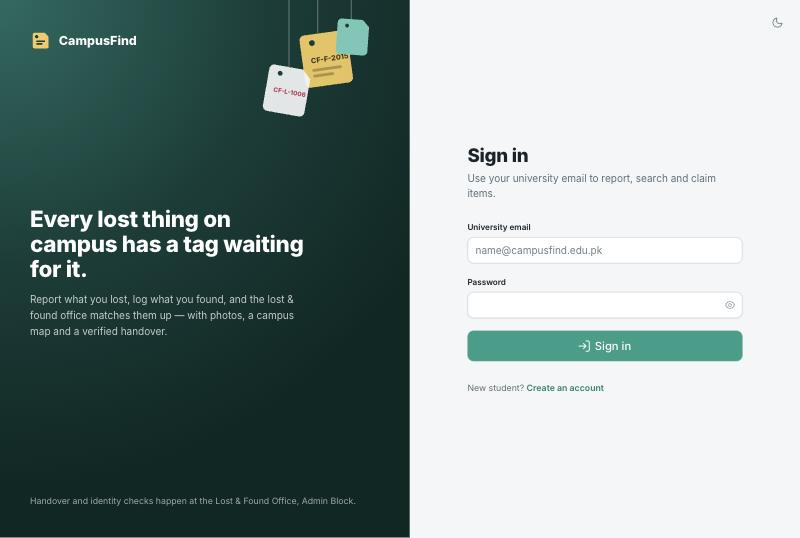 | 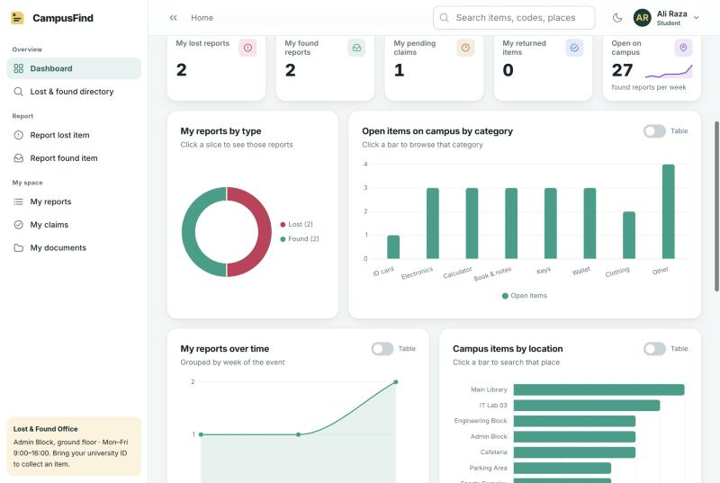 |
| 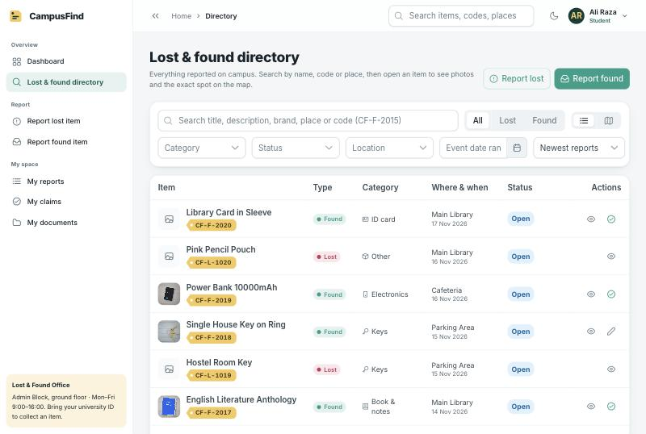 | 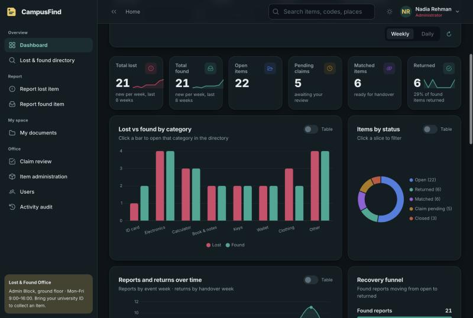 |
| 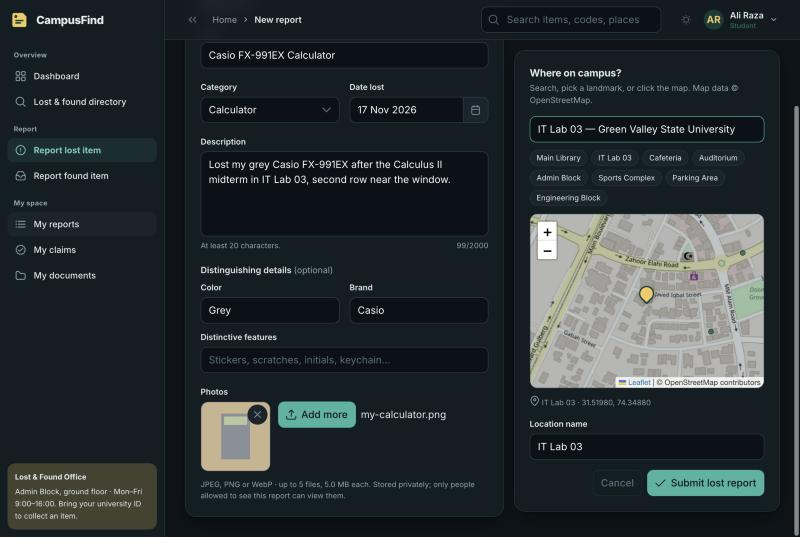 | 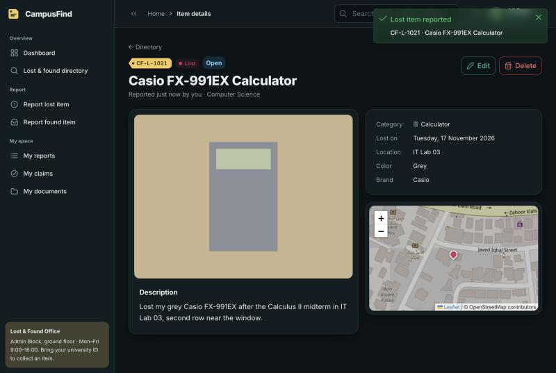 |
| 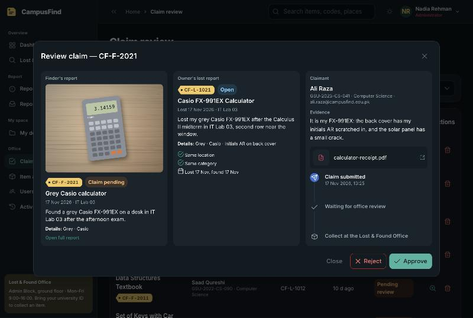 | 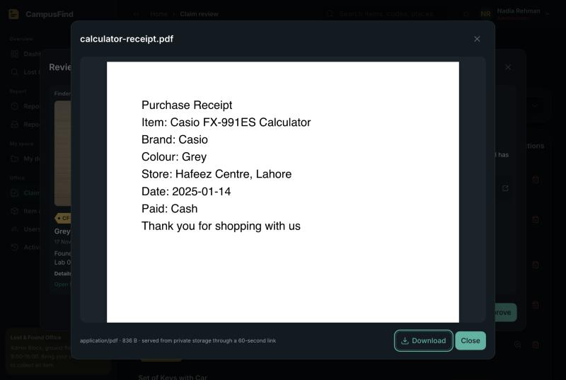 |
| 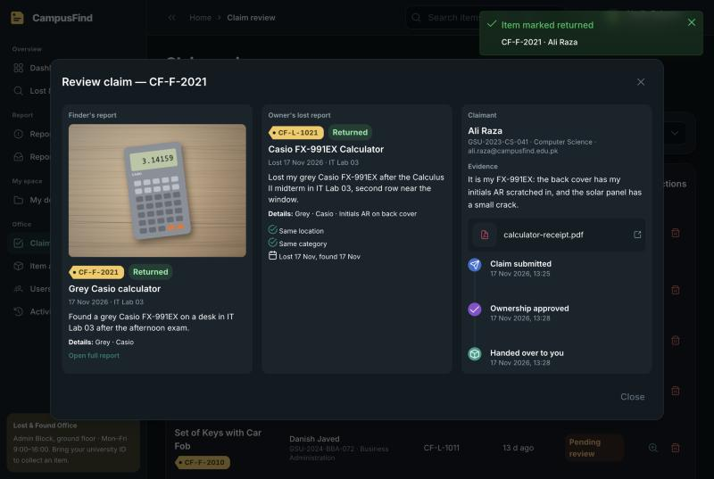 | 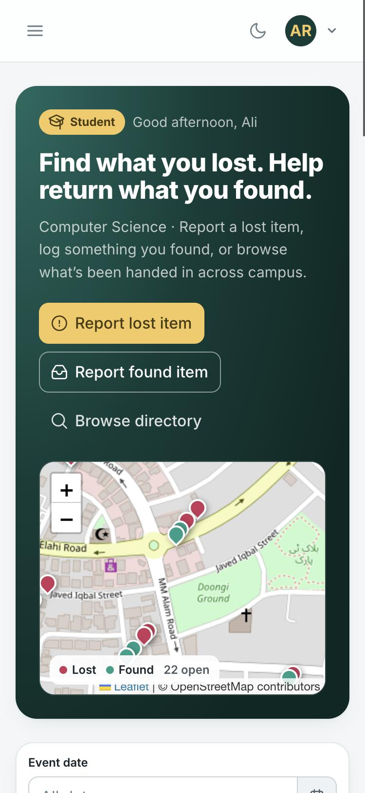 |

Judge walkthrough and Q&A: see the backend repo's `docs/JUDGE_QA.md`.
